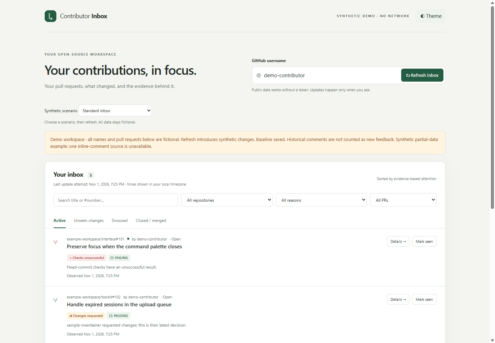

# Contributor Inbox

An evidence-backed attention queue for your open-source pull requests. See what changed, why a PR needs attention, and the GitHub event behind each signal. Built on the original **PR Watch** CLI, which remains supported.

## Start the local app

Requires Python 3.10+. No Python packages, account connection or frontend build needed to run the committed version.

```sh
git clone https://github.com/wBaob/pr-watch.git
cd pr-watch
python -m inbox.server
```

Open **http://127.0.0.1:8765**, enter your GitHub username and click **Refresh inbox**. Updates are manual. The service is bound to loopback and never writes to GitHub. Stop with Ctrl+C. On Windows, `py` can replace `python`.

### Explore without GitHub

```sh
python -m inbox.server --demo
```

Demo mode has a separate database, makes no API requests and uses clearly fictional data. The first refresh introduces feedback and a changed head commit. Further refreshes introduce another fictional comment. The demo scenario selector also offers empty, offline, rate-limit, closed/merged and long-title states; choose a scenario and refresh. Existing actions persist. Do not supply a live database to demo mode.



## What you can do

- Filter open PRs by repository, attention reason, draft and title/number.
- Inspect CI failures, change requests, newly observed feedback and head changes, with evidence links.
- Read a PR timeline and per-source observation timestamps; see missing or inaccessible sources explicitly.
- Mark changes seen. Persistent failures and change requests stay visible; later events become unseen again.
- Snooze a PR until a date/time, find it in Snoozed, and cancel. New events are retained while snoozed.
- Reopen the app and keep snapshots, local actions and transition history.
- Use light/dark themes and a responsive keyboard-accessible interface.

The first successful fetch of each source is a baseline, not a flood of new notifications. REST mode cannot determine review-thread resolution. Nothing in this app asserts merge readiness or that a maintainer owes a reply.

## Configuration and privacy

| Option | Default | Purpose |
| --- | --- | --- |
| `--port` | `8765` | Local HTTP port |
| `--db` | `.data/inbox.sqlite3` | Local SQLite path; demo uses `.data/demo.sqlite3` |
| `--limit` | `20` | Discover up to 1–1000 open PRs per refresh; warn when limited |
| `--demo` | off | Synthetic offline workspace |
| `GITHUB_TOKEN` | unset | Optional server-side read token |

Public data works without a token but has lower API limits. Private repositories additionally require suitable read permissions (PRs, issues/comments, checks and commit statuses). Set an optional token in the **server environment**, never in a browser field or source file. `.env.example` documents the variable; the server does not automatically load `.env`. The token is not sent to the UI, persisted or logged.

Database files contain local metadata and comment excerpts, potentially private when a token is used. They are ignored by git, not encrypted. Keep them private. Use separate databases for independent workspaces. One server process per database is supported. To reset, stop the server and move the database aside as a backup, or use a fresh `--db` path.

Sources update independently; failed fetches preserve their last successful snapshot. The UI shows source freshness, failed update warnings and rate-limit cooldown time. Old data is not a current success. Serial requests, conditional caching and no automatic retries keep API usage controlled. A high PR limit may make refresh take minutes. No background polling, notifications, telemetry or cloud deployment is included.

## Development

Python remains dependency-free at runtime. TypeScript is the only npm development dependency. Compiled `web/app.js` is committed so users can run without Node.

```sh
npm ci --ignore-scripts
npm run check
npm run build
python -m unittest -v
```

After editing TypeScript, commit its compiled JavaScript too; CI checks they match. Tests run offline and without tokens. See [ARCHITECTURE.md](ARCHITECTURE.md) for rules, schema version/migrations, security boundaries and limitations, and [verification notes](docs/VERIFICATION.md) for dated browser/live checks.

## Local API

`GET /api/state` returns username, mode, sync status and rows with sources, errors, attention reasons, timeline, sequence markers and snooze state. The transient CSRF value is for same-origin local actions. `POST /api/sync` and `/api/action` require exact Origin, JSON and `X-Inbox-CSRF`. These are local operations; no GitHub writes occur. Treat state responses as private when monitoring private repositories. The legacy CLI JSON contract remains unchanged; this richer local UI schema is separate.

## Original CLI

Requires Python 3.10 or newer.

```sh
git clone https://github.com/wBaob/pr-watch.git
cd pr-watch
python pr_watch.py wBaob
python pr_watch.py octocat --limit 5 --json
```

On Windows, `py` can be used instead of `python`.

Public requests work without a token, subject to GitHub's unauthenticated API limits. Each PR needs several API requests. If needed, set `GITHUB_TOKEN` in your environment; never put it in source code, command arguments or an issue. Only grant read access to the repositories and metadata you need (pull requests, checks and commit statuses). The tool never writes to GitHub. A token can expose private PR metadata in the report, so review reports before sharing them.

## Output

Each entry includes a clickable PR URL, CI summary and review counts. `--json` emits a timestamped report for use by other tools. Default: the 10 most recently updated open PRs; `--limit` accepts 1–100. A warning identifies truncated or incomplete results. Exit code `0` means the report was retrieved, `1` means a fatal API error, and `2` means a partial report or a result limit was reached. Failing CI is report data, not a CLI error.

CI states: `PASSING`, `FAILING`, `PENDING`, `NO_CHECKS` or `UNKNOWN`. Both check runs and legacy commit statuses are included. Neutral/skipped checks are treated as non-failing. Missing or inaccessible results are never presented as passing.

## Scope and limitations

- This is a one-shot snapshot. Run it again to refresh; there is no background service or notification delivery.
- CI is for the PR head commit in the base repository. Synthetic merge-commit checks, required-check policies and merge queues may differ. This is not a merge-readiness decision.
- Review counts use each reviewer's latest approval/change-request decision; comments do not overwrite decisions. These counts are not GitHub's branch-protection review decision and do not establish reviewer authority or approval freshness after new commits.
- Search indexing can lag; a PR may close between discovery and inspection. JSON includes its observed state.
- Large review/check histories are paginated, with a 100-page safety limit. Errors and rate limits are explicit; there are no automatic retries.
- Supports github.com only. No affiliation with or endorsement by GitHub.

## GitHub API references

- [Search issues and pull requests](https://docs.github.com/en/rest/search#search-issues-and-pull-requests)
- [Pull requests](https://docs.github.com/en/rest/pulls/pulls)
- [Check runs](https://docs.github.com/en/rest/checks/runs)
- [Commit statuses](https://docs.github.com/en/rest/commits/statuses)
- [Pull request reviews](https://docs.github.com/en/rest/pulls/reviews)

## Support

Use [repository issues](https://github.com/wBaob/pr-watch/issues) for bugs and feature requests. Do not include tokens or private repository information.

## License

MIT. See [LICENSE](LICENSE).
